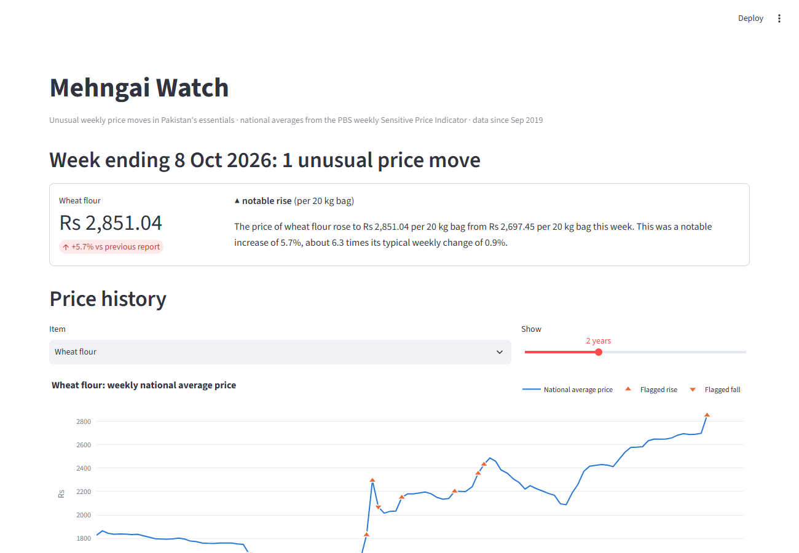

# Mehngai Watch (مہنگائی واچ)

**An early-warning tool for unusual price spikes in Pakistan's everyday essentials.**
Every week it reads the government's price data, works out which moves are *abnormal for that item*,
and writes a short plain-language alert.



> **This week (8 Oct 2026):** The price of wheat flour rose to Rs 2,851.04 per 20 kg bag from Rs 2,697.45
> per 20 kg bag this week. This was a notable increase of 5.7%, about 6.3 times its typical weekly change of 0.9%.
>
> — [full weekly report](reports/2026-10-08.md)

---

## The problem

Prices rise every week in Pakistan, so "the price went up" is not news. Households and small shopkeepers
can't tell normal inflation apart from **abnormal spikes**: shortages, floods, seasonal jumps before Ramazan.
The Pakistan Bureau of Statistics (PBS) publishes the data every week, but only as dense PDF tables.

Mehngai Watch answers one question: **"Is this week's jump abnormal compared with how this item
normally behaves, and if so, what happened in plain words?"**

## What it does

- Tracks **8 essentials** (wheat flour, sugar, tomatoes, onions, potatoes, chicken, eggs, ghee), national
  average prices, every week since **Sep 2019** (354 weeks).
- Flags a week when an item's change is far outside **its own** normal range. A 10% week is ordinary for
  tomatoes but extreme for sugar.
- An LLM turns each flag into 1–2 sentences, **using only numbers computed by the code**, and every sentence
  is checked automatically before it is shown.
- Produces a weekly Markdown report and a local dashboard.

## How it works

```
 PBS weekly SPI PDFs ─► 1. fetch ─► 2. parse ─► 3. clean & validate ─► 4. SQLite ─► 5. detect ─► 6. explain ─► 7. report
 (live site + Wayback)     PDFs      tables       reject misreads        prices      robust z     LLM + checks    .md + dashboard
```

| Stage | What happens | Key idea |
|---|---|---|
| Fetch | Finds report links through the PBS site's file API and, for older years, the Internet Archive | PBS redesigned its website and old links died; history survives on the Wayback Machine. Truncated archive copies are detected and replaced. |
| Parse | Extracts the city-wise price table (Appendix-A) with `pdfplumber` | That table keeps prices clean even where long item names garble other tables. |
| Clean & validate | Maps items, rejects impossible values (blank, ≤ 0, min/avg/max out of order, > ×4 jump) | A misread number looks exactly like a price spike, so it must never reach the detector. |
| Store | One SQLite file; rebuilt idempotently | The database is the single source of truth. |
| Detect | **Rolling robust z-score**: this week's change vs the item's previous 52 weeks, using median and MAD | Per-item scale; one past spike can't hide the next; no look-ahead. |
| Explain | Gemini (free tier) writes the alert from a small facts JSON | Guardrails: every number must come from the facts; no causes or blame; retry once, then a template. |
| Report | `reports/YYYY-MM-DD.md` + Streamlit dashboard | A quiet week still gets a report: "no unusual moves", plus all prices. |

## Does it work? (evaluation)

There's no labelled list of "true anomalies", so I built one from news coverage: **8 documented price
shocks** (2022 floods, the record flour price of Mar 2023, the sugar surge of Aug 2023, and others), each with a
source link in [`data/known_events.csv`](data/known_events.csv). Every detector was **backtested week by week
with no look-ahead** over Sep 2021 – Oct 2026.

| Detector | Alerts / week | Recall (8 events) | Event precision* | Share of alerts on the noisiest item |
|---|---|---|---|---|
| L0: fixed "more than 10%" rule (baseline) | 1.13 | 0.75 | 0.04 | 53% (tomatoes) |
| **L1: rolling robust z-score, 52 weeks** ✅ | **0.45** | **0.75** | **0.10** | 32% |
| L2: L1 minus general inflation | 0.44 | 0.75 | 0.09 | 35% |
| L3: L1 minus seasonality (STL) + Ramazan effect | 0.59 | 0.75 | 0.07 | 26% |

\*Share of alerts inside a known event: a lower bound, since many real shocks aren't on the list.

- **L1 was chosen.** Same recall as the baseline with **60% fewer alerts**. The baseline spends half its alerts
  on routine tomato swings and almost never flags sugar, flour or ghee.
- **Spot check:** in 14 L1 alerts checked against the news, 13 were real reported price moves and 7 had a
  stated cause (for example: flour mills raised prices by Rs 330 per bag in Sep 2022; palm-oil containers were
  stuck at Karachi port in Feb 2023).
- **More complex didn't win.** Subtracting inflation (L2) changed nothing measurable. Seasonal modelling (L3)
  needs more years than the 5 available: it mistook one-off jumps for "seasons".
- **Honest limitations:** only 8 known events, so recall moves in 12.5-point steps. L1 treats even big tomato
  swings as normal *for tomatoes* (it missed the two tomato events). Full details and the tuning log are in
  [`docs/decisions.md`](docs/decisions.md).

## Run it yourself

Needs Python 3.11+ and a free [Gemini API key](https://aistudio.google.com/apikey). Everything used is free.

```bash
git clone https://github.com/massabibrahim13/Mehengai-Watch.git
cd Mehengai-Watch
python -m venv .venv
.venv\Scripts\activate          # Windows  (macOS/Linux: source .venv/bin/activate)
pip install -r requirements.txt
pip install -e .

copy .env.example .env          # then put your key in .env:  LLM_API_KEY=...

python -m mehngai.pipeline      # fetch → parse → store → detect → explain → report
streamlit run src/mehngai/app/dashboard.py
```

The **first run downloads about 380 PDFs** (roughly an hour, mostly from the Internet Archive, with polite delays).
After that a weekly run takes seconds: downloads, parsed tables and explanations are all cached.
Without an API key, or once the free quota (20 requests/day) is used up, alerts fall back to a checked template
sentence, so the report still works.

Other commands:

| Command | What it does |
|---|---|
| `python -m mehngai.detect.evaluate` | Full backtest of all four detectors (~3 min) |
| `python -m mehngai.explain --sample 10` | Explain 10 varied historical alerts (guardrail check) |
| `python -m mehngai.report.weekly_report --week 2023-03-22` | Report for any past week |
| `pytest` | 70 tests: parsing, validation, detectors (incl. no-look-ahead), guardrails, report, dashboard |

## Project structure

```
config/           items.yaml (tracked items) · settings.yaml (thresholds, windows, model)
data/             known_events.csv (evaluation ground truth); raw PDFs, CSVs and the DB are generated, not committed
src/mehngai/
  ingest/         fetch.py · parse.py
  clean/          normalize.py · validate.py
  store/          db.py
  detect/         baseline.py (L0) · zscore.py (L1) · relative.py (L2) · seasonal.py (L3) · evaluate.py · run.py
  explain/        facts.py · llm.py · guardrails.py · prompts/
  report/         weekly_report.py · charts.py
  app/            dashboard.py (Streamlit)
  pipeline.py     runs everything with one command
notebooks/        01_explore.ipynb (exploration, charts)
reports/          generated weekly reports
docs/             decisions.md (why X over Y) · learning-log.md
tests/
```

## Important

- Flags are **statistical signals, not accusations**. They say a price moved unusually, not why or who is
  responsible. The explanations are not allowed to state causes or blame anyone.
- This is an independent student project, **not an official PBS product**. Prices are PBS national averages
  across 17 cities. Always check the [original PBS data](https://www.pbs.gov.pk/price-statistics/).

## Credits

Built by **Massab Ibrahim** as the course project for the **Edversity AI Solutions Engineers course
(Cohort 1)**, based on the course's "market and price monitoring agent" idea, re-scoped to a Pakistani
public-interest problem.

Data: Pakistan Bureau of Statistics, weekly Sensitive Price Indicator. Historical files via the Internet
Archive's Wayback Machine.
