# Mehngai Watch (مہنگائی واچ)

**An early-warning tool for unusual price moves in Pakistan's essentials.**
Every week it reads the government's price data for 51 essentials, works out which moves are *abnormal for
that item*, lists government price changes separately, and explains it all in plain language, alongside the
latest price news.

**Live site: [https://massabibrahim13.github.io/Mehengai-Watch/](https://massabibrahim13.github.io/Mehengai-Watch/)**. It updates itself: every two hours it checks PBS for a new weekly report and refreshes the price news. For a guided look, see the [5-minute demo](#demo-a-5-minute-tour).

> **Week ending 15 Oct 2026:** Chana daal (gram) prices rose 5% to Rs 300.29 per kg, an unusual move for this
> item (about 9.4 times its typical weekly change of 0.5%). It is the largest weekly increase since Aug 2024.
> No government-set price changed this week.
>
> — [full weekly report](reports/2026-10-15.md)

---

## The website

A React website is the public face of the project (the Streamlit dashboard further down is now a private analysis
tool). It opens on ribbons of fine
flowing lines that drift slowly, speed up and bend around your pointer, and ripple where you click, next to this
week's biggest price moves. Five sections follow: **This week** (our Essentials index, the alerts with plain-language
explanations, government price changes), **Prices** (all 51 items as a sortable list or a heatmap), **Cities**,
**News** (each headline next to the price it mentions), **How it works** and **Evidence** (how we tested it: the
detector backtest and the check against PBS's own figures). Every item has its own link (e.g. `#/item/sugar`), and an
**"Ask about prices"** chat answers questions such as "cheapest city for aata" or "how much has petrol gone up since
last year" from the data; when a question is hard to read, an AI helps understand it but never writes a number. The
Python pipeline exports small JSON files; the site only displays them.

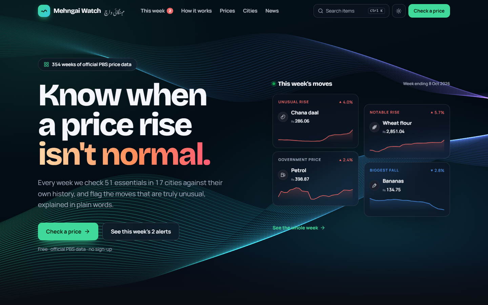

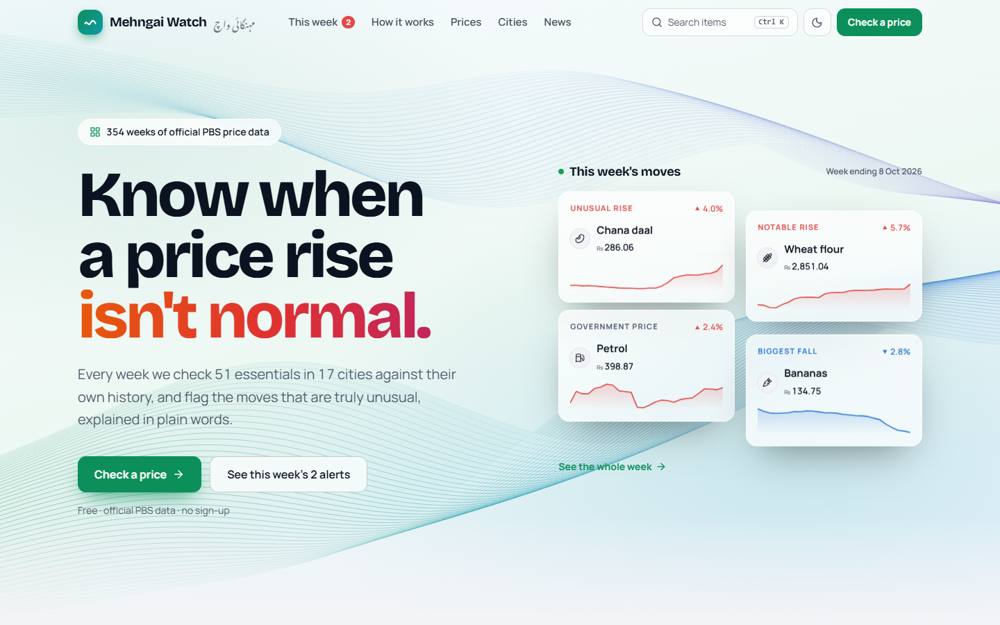

| This week | Every price |
|---|---|
| 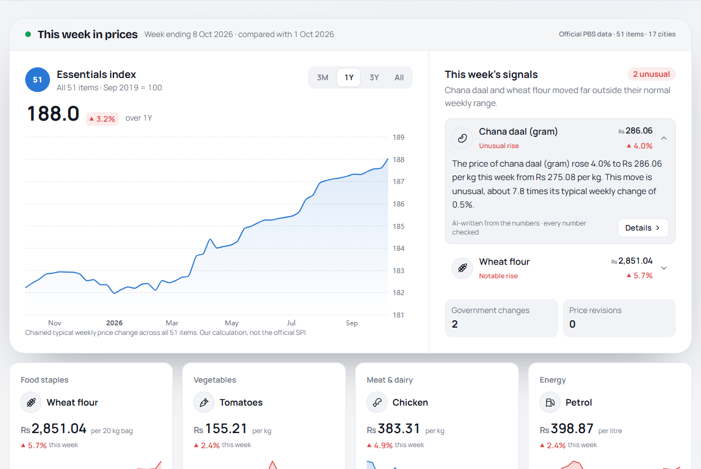 | 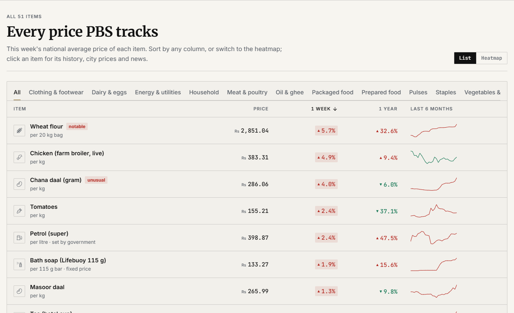 |

| News with live prices | Where it costs more |
|---|---|
| 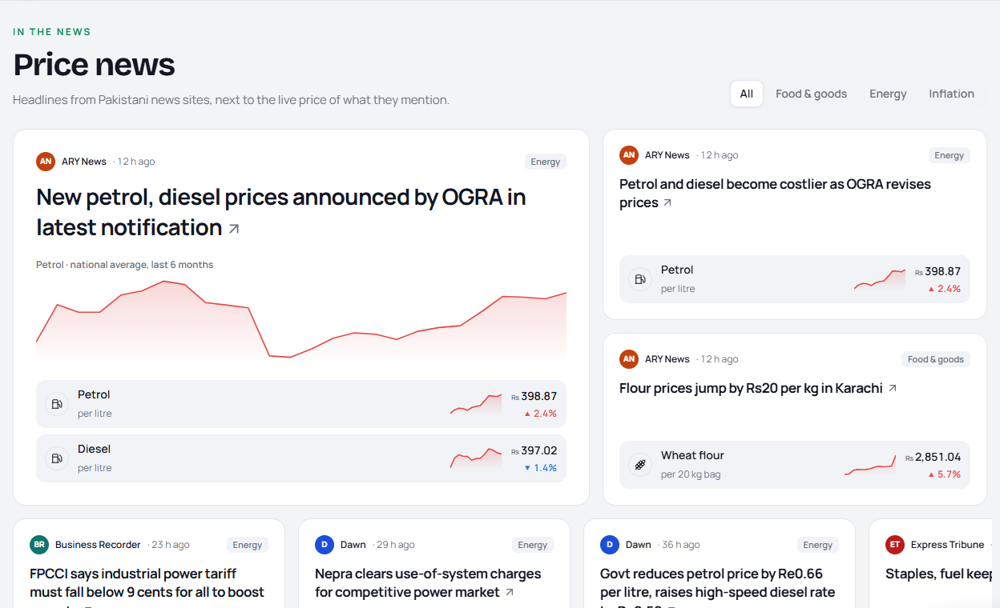 | 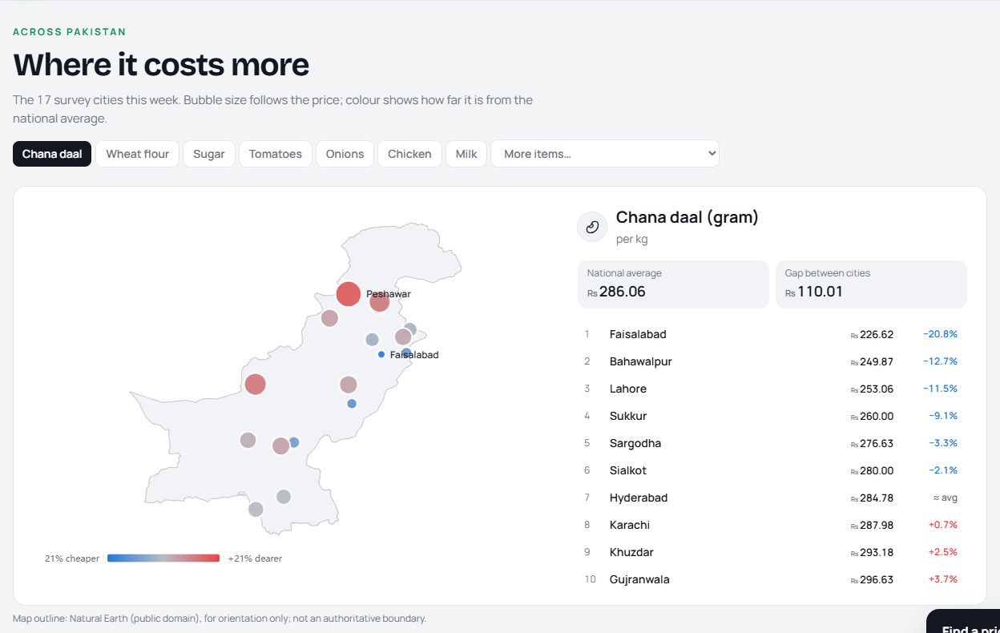 |

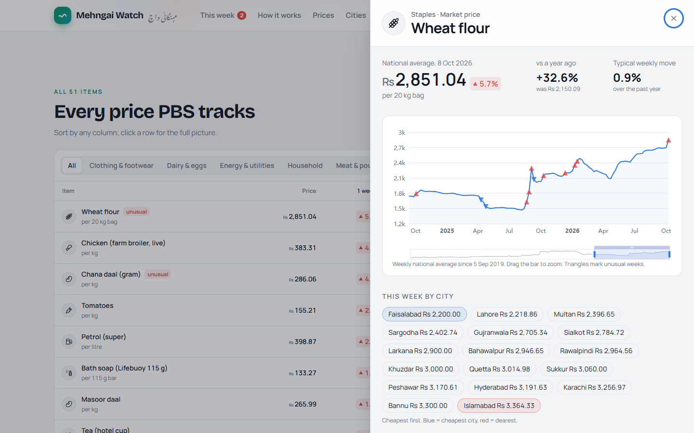

Run it locally (needs Node.js): `python -m mehngai.export`, then `cd web`, `npm install`, `npm run dev`, and open
http://localhost:5173.

## Demo: a 5-minute tour

Everything below happens on the live site, and works the same on a phone. Prices change every week; the examples are
from the week ending 15 Oct 2026.

| # | Do this | What it shows |
|---|---|---|
| 1 | Open the [live site](https://massabibrahim13.github.io/Mehengai-Watch/) and read the four **This week's moves** cards beside the waves. | The question the project answers: not "did prices go up?" but "is this move abnormal *for this item*?" (chana daal +5%, about 9 times its usual weekly move). |
| 2 | Scroll to **This week** and read the open alert, including the small line under it. | The statistics decide what is unusual; the AI only words it, and every number it writes is checked against the data. "Standard summary" means the AI's sentence failed a check (or the free AI quota ran out), so a fixed template was used instead. |
| 3 | Look at the **Government price changes** and **Price revisions** boards below it. | Petrol, electricity or gas prices change by government decision, so they are listed separately and never called anomalies. |
| 4 | In **Prices**, sort by **1 week**, then switch from **List** to **Heatmap**. | All 51 items at a glance. A 10% week is ordinary for tomatoes but extreme for sugar, which is why each item is judged against its own history. |
| 5 | Click an item (say, Sugar), drag the bar under its chart, then press **Copy link**. | Weekly prices since Sep 2019, with triangles on the weeks the detector flagged. Every item has its own shareable link (`#/item/sugar`). |
| 6 | In **Cities**, pick an item. | This week's price in the 17 survey cities: red is dearer than the national average, green is cheaper. |
| 7 | Type `aata`, then `ٹماٹر`, in the search box at the top. | Search understands English, Roman Urdu and Urdu names. |
| 8 | Press **Ask about prices** (bottom right, once you scroll past the top). Ask `cheapest city for aata`, then `which city sells the hen meat for the least`. | Simple questions are answered by rules, straight from the data. A question the rules can't read goes to an AI that only turns it into fields (item, city, dates); the answer and its numbers still come from the data. The AI helper allows 3 questions per visitor a day, to stay on the free tier; when it is busy, the chat says so. |
| 9 | Open **Evidence**. | How we know it works: a backtest against 8 documented price shocks (the detector caught 6, with about one alert a week) and a check against PBS's own printed figures (all 17,952 weekly prices match). |
| 10 | On GitHub, open [Actions → Update and publish](https://github.com/massabibrahim13/Mehengai-Watch/actions/workflows/update.yml). | The site updates itself: every two hours it checks PBS for a new report, runs the pipeline and the tests, then publishes. A failing test stops the publish, as it did on 16 Oct 2026 when the backup AI model left the % change out of an explanation; the guardrail now requires it. |

## The problem

Prices rise every week in Pakistan, so "the price went up" is not news. Households and small shopkeepers
can't tell normal inflation apart from **abnormal spikes**: shortages, floods, seasonal jumps before Ramazan.
The Pakistan Bureau of Statistics (PBS) publishes the data every week, but only as dense PDF tables.

Mehngai Watch answers one question: **"Is this week's jump abnormal compared with how this item
normally behaves, and if so, what happened in plain words?"**

## What it does

- Tracks **all 51 items** of PBS's weekly Sensitive Price Indicator, every week since **Sep 2019** (354 weeks),
  for the national average and 17 cities.
- Sorts them into three groups, because their prices behave differently. Each group gets its own section:

  | Section | Items | What's shown |
  |---|---|---|
  | **1. Unusual price moves** | 25 market-priced items: flour, rice, sugar, vegetables, meat, milk, eggs, oil, pulses… | A week is flagged when the change is far outside the item's **own** normal range. A 10% week is ordinary for tomatoes but extreme for sugar. |
  | **2. Government price changes** | Petrol, diesel, LPG, electricity, gas, phone charges | Every change of 1% or more, framed as a policy decision, never as an "anomaly". |
  | **3. Price revisions** | 20 packaged, branded and hotel prices: tea, salt, soap, Bata shoes, cloth… | Every step of 2% or more. These prices stay flat for months, then jump once. |

- An LLM turns each unusual move into 1–2 sentences, **using only numbers computed by the code**. Every
  sentence is checked automatically before it is shown.
- **Search** any item by English, Roman Urdu or Urdu name (aata, cheeni, ٹماٹر, bijli…).
- **Ask** questions such as "cheapest city for sugar" or "how much has petrol gone up since last year?".
  Answers come straight from PBS data.
- **Live price news:** headlines from Pakistani news sites, matched to the items they mention, refreshed every
  two hours.
- A weekly Markdown report and a three-page dashboard (Home · Explore · Ask).

| This week's sections + headlines | Dark mode |
|---|---|
| 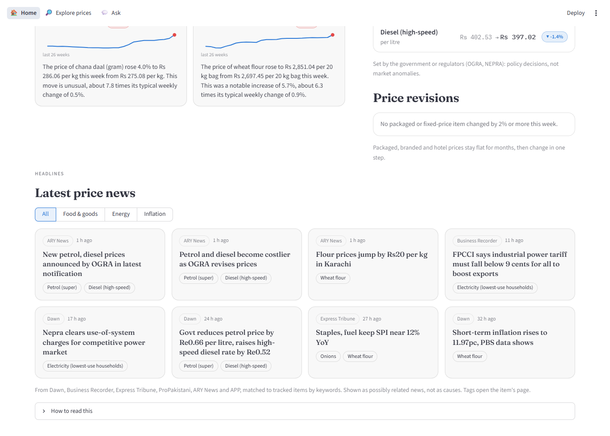 | 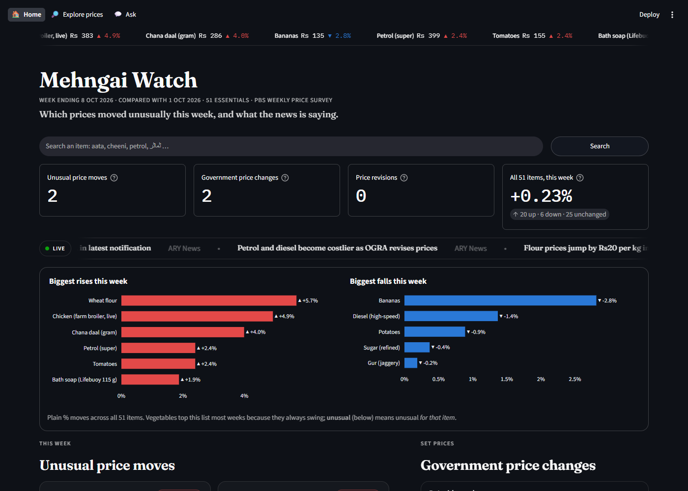 |
| **Explore any item** | **Ask a question** |
| 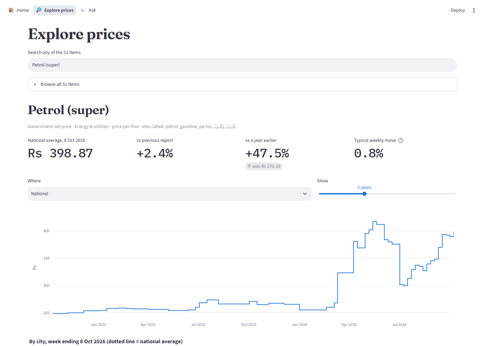 | 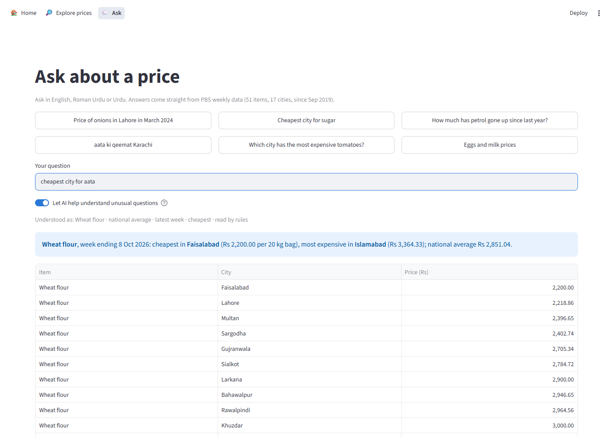 |

The home page has a slow-scrolling price ticker (all 51 items) and a live headline strip, both pausing on hover.
Cards, news and buttons react to the mouse, and every item name, ticker entry and news tag opens that item's
page. It works in light and dark mode, and motion stops if the computer's "reduce motion" setting is on.

## How it works

```
 PBS weekly SPI PDFs ─► 1. fetch ─► 2. parse ─► 3. clean & validate ─► 4. SQLite ─► 5. detect ─► 6. explain ─► 7. report
 (live site + Wayback)     PDFs      tables       reject misreads        prices      robust z     LLM + checks    .md + dashboard
                                                                                     + set-price   + news RSS
                                                                                       changes     headlines
```

| Stage | What happens | Key idea |
|---|---|---|
| Fetch | Finds report links through the PBS site's file API and, for older years, the Internet Archive | PBS redesigned its website and old links died; history survives on the Wayback Machine. Truncated archive copies are detected and replaced. |
| Parse | Extracts the city-wise price table (Appendix-A) with `pdfplumber` | That table keeps prices clean even where long item names garble other tables. |
| Clean & validate | Maps 51 items, rejects impossible values (blank, 0, min/avg/max out of order, > ×4 jump) | A misread number looks exactly like a price spike, so it must never reach the detector. Government prices are exempt from the ×4 rule: gas really went Rs 295 → 1,711 in Nov 2023. |
| Store | One SQLite file; rebuilt idempotently | The database is the single source of truth. |
| Detect | **Rolling robust z-score** for market items: this week's change vs the item's previous 52 weeks, using median and MAD. Fixed and government prices: list changes above a threshold. | Per-item scale; one past spike can't hide the next; no look-ahead. Policy changes are never called anomalies. |
| Explain | Gemini (free tier) writes the alert from a small facts JSON | Guardrails: every number must come from the facts; no causes or blame; retry once, then a template. |
| News | Public RSS feeds (Dawn, Business Recorder, Express Tribune, ProPakistani, ARY, APP), kept when a headline names a tracked item and a price word | Shown as "possibly related" with links. No AI summary, so no invented causes. |
| Search & ask | Alias matching (English / Roman Urdu / Urdu, typos); questions read by rules, with AI only as a fallback that may return a structured question and nothing else | Every number in an answer comes from the database. |

## Does it work? (evaluation)

There's no labelled list of "true anomalies", so I built one from news coverage: **8 documented price
shocks** (2022 floods, the record flour price of Mar 2023, the sugar surge of Aug 2023, and others), each with a
source link in [`data/known_events.csv`](data/known_events.csv). Every detector was **backtested week by week
with no look-ahead** over Sep 2021 – Oct 2026. The detector was chosen on the original 8 items:

| Detector | Alerts / week | Recall (8 events) | Event precision* | Share of alerts on the noisiest item |
|---|---|---|---|---|
| L0: fixed "more than 10%" rule (baseline) | 1.13 | 0.75 | 0.04 | 53% (tomatoes) |
| **L1: rolling robust z-score, 52 weeks** ✅ | **0.45** | **0.75** | **0.10** | 32% |
| L2: L1 minus general inflation | 0.44 | 0.75 | 0.09 | 35% |
| L3: L1 minus seasonality (STL) + Ramazan effect | 0.59 | 0.75 | 0.07 | 26% |

\*Share of alerts inside a known event: a lower bound, since many real shocks aren't on the list.

- **L1 was chosen.** Same recall as the baseline with **60% fewer alerts**. The baseline spends half its alerts
  on routine tomato swings and almost never flags sugar, flour or ghee.
- **Extended to all 25 market items**, L1 gives about **1 alert per week**, spread evenly (no item gets more
  than 15% of alerts), with the same recall.
- **Spot check:** in 14 L1 alerts checked against the news, 13 were real reported price moves and 7 had a
  stated cause (for example: flour mills raised prices by Rs 330 per bag in Sep 2022; palm-oil containers were
  stuck at Karachi port in Feb 2023).
- **More complex didn't win.** Subtracting inflation (L2) changed nothing measurable. Seasonal modelling (L3)
  needs more years than the 5 available: it mistook one-off jumps for "seasons".
- **Honest limitations:** only 8 known events, so recall moves in 12.5-point steps. L1 treats even big tomato
  swings as normal *for tomatoes* (it missed the two tomato events). Full details and the tuning log are in
  [`docs/decisions.md`](docs/decisions.md).

### Are the numbers right? (cross-check with PBS)

Each PBS report prints, next to its national average, PBS's own previous-week price, same-week-last-year price and
% changes. The pipeline never uses those columns; it computes everything itself. So comparing the two checks
parsing, storage and the formulas independently: **Over all 352 reports since Sep 2019, this week's price matches PBS on 17,952 of 17,952 values (100%), the previous week on 98.7% and the year-ago price on 99.7%; every difference is PBS later correcting an earlier week's figure, or a week missing from our archive.** Full table: [`docs/verification.md`](docs/verification.md);
re-run with `python -m mehngai.verify --all`. Every weekly run also checks the newest report this way.

## Run it yourself

Needs Python 3.11+ and a free [Gemini API key](https://aistudio.google.com/apikey). Everything used is free.

```bash
git clone https://github.com/massabibrahim13/Mehengai-Watch.git
cd Mehengai-Watch
python -m venv .venv
.venv\Scripts\activate          # Windows  (macOS/Linux: source .venv/bin/activate)
pip install -r requirements.txt
pip install -e .

copy .env.example .env          # then put your key in .env:  LLM_API_KEY=...

python -m mehngai.pipeline      # fetch → parse → store → detect → explain → news → report
streamlit run src/mehngai/app/dashboard.py
```

The parsed price tables (`data/interim/`), the download list and the saved AI explanations are in the repo, so a
fresh clone rebuilds everything in about 30 seconds and only downloads reports newer than the repo. (To re-parse
every PDF from scratch, delete `data/interim/`: the first run then downloads about 380 PDFs, roughly an hour.)

**Automatic updates.** [`.github/workflows/update.yml`](.github/workflows/update.yml) runs on GitHub Actions for
free, every two hours: it checks the PBS site for a new report (a few small requests), and when one has arrived it
runs the pipeline and the tests, commits the new week's data and publishes the site; otherwise it just refreshes the
news and republishes. (A frequent cheap check, because GitHub may delay or skip scheduled runs.) The Gemini key is a
repository secret (`LLM_API_KEY`).
Without an API key, or once the free quota (20 requests/day) is used up, alerts fall back to a checked template
sentence, so the report still works.

Other commands:

| Command | What it does |
|---|---|
| `python -m mehngai.detect.evaluate` | Full backtest of all four detectors on the 25 market items (~10 min) |
| `python -m mehngai.explain --sample 10` | Explain 10 varied historical alerts (guardrail check) |
| `python -m mehngai.news` | Fetch the latest price headlines now |
| `python -m mehngai.report.weekly_report --week 2023-11-16` | Report for any past week |
| `python -m mehngai.agent "is the chana daal rise normal?"` | Ask the price agent (in development): it looks up the data with tools and explains, every number checked. See [`docs/langsmith.md`](docs/langsmith.md) |
| `python -m mehngai.agent.evaluate` | Run the agent on its test questions as a LangSmith experiment (needs a free LangSmith key) |
| `pytest` | 144 tests: parsing, validation, detectors (incl. no-look-ahead), guardrails, data accuracy against PBS, search, ask, the price agent, news, report, dashboard pages |

## Project structure

```
config/           items.yaml (51 items: group, unit, aliases) · settings.yaml (thresholds, model, news feeds)
data/             known_events.csv (evaluation ground truth) · interim/ (parsed price tables, committed);
                  raw PDFs and the DB are generated, not committed
src/mehngai/
  ingest/         fetch.py · parse.py
  clean/          normalize.py · validate.py
  store/          db.py
  detect/         baseline.py (L0) · zscore.py (L1) · relative.py (L2) · seasonal.py (L3) · changes.py · evaluate.py · run.py
  explain/        facts.py · llm.py · guardrails.py · prompts/
  report/         weekly_report.py · charts.py
  app/            dashboard.py · home.py · explore.py · ask_page.py · common.py · style.py (Streamlit)
  search.py       item search (English / Roman Urdu / Urdu, typos)
  ask.py          question → structured lookup → answer from the database
  news.py         price headlines from Pakistani RSS feeds
  verify.py       checks our numbers against the figures PBS prints in each report
  export.py       writes the small JSON files the website reads (web/public/data/)
  pipeline.py     runs everything with one command
web/              the website (React + TypeScript + Vite); reads only the JSON exported by export.py
worker/           Cloudflare Worker for the chat: holds the Gemini key, turns hard questions into fields
notebooks/        01_explore.ipynb (exploration, charts)
reports/          generated weekly reports
docs/             decisions.md (why X over Y) · learning-log.md
tests/
```

## Important

- Flags are **statistical signals, not accusations**. They say a price moved unusually, not why or who is
  responsible. The explanations are not allowed to state causes or blame anyone, and news headlines are shown
  only as possibly related.
- This is an independent student project, **not an official PBS product**. Prices are PBS averages across
  17 cities. Always check the [original PBS data](https://www.pbs.gov.pk/price-statistics/).

## Credits

Built by **Massab Ibrahim** as the course project for the **Edversity AI Solutions Engineers course
(Cohort 1)**, based on the course's "market and price monitoring agent" idea, re-scoped to a Pakistani
public-interest problem.

Data: Pakistan Bureau of Statistics, weekly Sensitive Price Indicator. Historical files via the Internet
Archive's Wayback Machine. Headlines link to their publishers.
