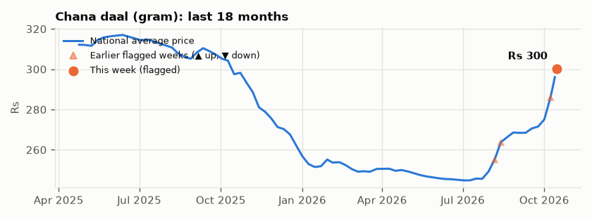

# Mehngai Watch — week ending 15 Oct 2026

Pakistan's 51 essentials (PBS weekly Sensitive Price Indicator, national averages), compared with the previous report (8 Oct 2026).

**This week:** 1 unusual price move · 0 government price changes · 0 price revisions

## 1. Unusual price moves

Market-priced items whose weekly change is far outside their own normal range.

### ▲ Chana daal (gram) — unusual rise

**Rs 300.29 per kg** (+5% vs 8 Oct 2026)

> Chana daal (gram) prices rose 5% to Rs 300.29 per kg in the week ending 15 Oct 2026, an unusual move for this item (about 9.4 times its typical weekly change of 0.5%). It is the largest weekly increase since Aug 2024.

## 2. Government price changes

Prices set by the government or regulators (OGRA, NEPRA): policy decisions, not market anomalies. Listed when the national price moved 1% or more.

No government-set price changed this week.

## 3. Price revisions

Packaged, branded and hotel prices stay flat for months, then change in one step. Listed when the national price moved 2% or more.

No price revisions this week.

## Price news this week

Headlines mentioning the items above, from Pakistani news sites. Possibly related; not presented as causes.

- [Short-term inflation surges to 11.38pc due to costly food](https://www.dawn.com/news/2037605/short-term-inflation-surges-to-1138pc-due-to-costly-food) (Dawn)
- [Staples, fuel keep SPI near 12% YoY](https://tribune.com.pk/story/2633984/staples-fuel-keep-spi-near-12-yoy) (Express Tribune)
- [Short-term inflation rises to 11.97pc, PBS data shows](https://www.dawn.com/news/2035917/short-term-inflation-rises-to-1197pc-pbs-data-shows) (Dawn)

<b>All 51 items this week</b>

| Category | Item | Price | Change vs previous report | Typical weekly move | Note |
|---|---|---:|---:|---:|---|
| Clothing & footwear | Gents sandal (Bata) | Rs 2,499.00 per pair | +0.0% | 0.0% | – |
| Clothing & footwear | Gents sponge chappal (Bata) | Rs 699.00 per pair | +0.0% | 0.0% | – |
| Clothing & footwear | Georgette | Rs 318.25 per metre | +0.0% | 0.0% | – |
| Clothing & footwear | Ladies sandal (Bata) | Rs 1,499.00 per pair | +0.0% | 0.0% | – |
| Clothing & footwear | Lawn (printed) | Rs 682.80 per metre | +0.0% | 0.0% | – |
| Clothing & footwear | Long cloth | Rs 691.45 per metre | +0.2% | 0.0% | – |
| Clothing & footwear | Shirting cloth | Rs 548.58 per metre | +0.6% | 0.0% | – |
| Dairy & eggs | Curd (dahi) | Rs 257.05 per kg | +0.1% | 0.0% | – |
| Dairy & eggs | Eggs (farm) | Rs 263.39 per dozen | +1.0% | 1.6% | – |
| Dairy & eggs | Milk (fresh) | Rs 218.92 per litre | +0.0% | 0.0% | – |
| Energy & utilities | Diesel (high-speed) | Rs 398.89 per litre | +0.5% | 1.5% | – |
| Energy & utilities | Electricity (lowest-use households) | Rs 7.66 per unit (kWh) | +0.0% | 0.0% | – |
| Energy & utilities | Gas (lowest-use households) | Rs 2,566.50 per MMBTU | +0.0% | 0.0% | – |
| Energy & utilities | LPG (11.67 kg cylinder) | Rs 5,154.16 per 11.67 kg cylinder | +0.4% | 1.4% | – |
| Energy & utilities | Petrol (super) | Rs 396.06 per litre | -0.7% | 0.9% | – |
| Energy & utilities | Telephone call charges | Rs 1.79 per minute | +0.0% | 0.0% | – |
| Household | Bath soap (Lifebuoy 115 g) | Rs 133.27 per 115 g bar | +0.0% | 0.0% | – |
| Household | Cigarettes (Capstan, 20) | Rs 253.23 per packet of 20 | +0.0% | 0.0% | – |
| Household | Energy saver bulb (Philips 14 W) | Rs 402.11 per bulb | +0.0% | 0.0% | – |
| Household | Firewood | Rs 1,513.18 per 40 kg | +0.7% | 0.1% | – |
| Household | Matchbox | Rs 6.31 per box | +0.0% | 0.0% | – |
| Household | Washing soap (Sufi 250 g) | Rs 144.42 per 250 g cake | +0.0% | 0.0% | – |
| Meat & poultry | Beef (with bone) | Rs 1,275.63 per kg | +0.0% | 0.1% | – |
| Meat & poultry | Chicken (farm broiler, live) | Rs 395.98 per kg | +3.3% | 5.4% | – |
| Meat & poultry | Mutton | Rs 2,400.26 per kg | +0.0% | 0.2% | – |
| Oil & ghee | Cooking oil (5 litre tin) | Rs 3,092.88 per 5 litre tin | +0.1% | 0.1% | – |
| Oil & ghee | Mustard oil | Rs 568.00 per kg | +0.0% | 0.1% | – |
| Oil & ghee | Vegetable ghee (1 kg pouch) | Rs 613.88 per 1 kg pouch | +0.2% | 0.1% | – |
| Oil & ghee | Vegetable ghee (2.5 kg tin) | Rs 1,571.29 per 2.5 kg tin | +0.0% | 0.1% | – |
| Packaged food | Bread (plain, small) | Rs 120.05 per loaf | +0.0% | 0.0% | – |
| Packaged food | Chilli powder (200 g) | Rs 372.39 per 200 g pack | +0.0% | 0.0% | – |
| Packaged food | Powdered milk (NIDO 390 g) | Rs 1,152.27 per 390 g pack | +0.0% | 0.0% | – |
| Packaged food | Salt (800 g pack) | Rs 61.87 per 800 g pack | +0.0% | 0.0% | – |
| Packaged food | Tea leaves (Lipton 190 g) | Rs 465.35 per 190 g pack | +0.0% | 0.0% | – |
| Prepared food | Cooked beef (hotel plate) | Rs 323.93 per plate | +0.0% | 0.0% | – |
| Prepared food | Cooked daal (hotel plate) | Rs 178.73 per plate | +0.6% | 0.0% | – |
| Prepared food | Tea (hotel cup) | Rs 66.87 per cup | +0.3% | 0.0% | – |
| Pulses | Chana daal (gram) | Rs 300.29 per kg | +5.0% | 0.5% | ▲ unusual |
| Pulses | Mash daal | Rs 469.06 per kg | +1.0% | 0.3% | – |
| Pulses | Masoor daal | Rs 268.53 per kg | +1.0% | 0.3% | – |
| Pulses | Moong daal | Rs 354.32 per kg | +0.1% | 0.3% | – |
| Staples | Gur (jaggery) | Rs 227.62 per kg | -0.4% | 0.2% | – |
| Staples | Rice (IRRI-6/9) | Rs 154.89 per kg | +0.0% | 0.0% | – |
| Staples | Rice (basmati, broken) | Rs 215.52 per kg | -0.7% | 0.0% | – |
| Staples | Sugar (refined) | Rs 142.11 per kg | -0.6% | 0.3% | – |
| Staples | Wheat flour | Rs 2,946.72 per 20 kg bag | +3.4% | 1.0% | – |
| Vegetables & fruit | Bananas | Rs 131.26 per dozen | -2.6% | 1.4% | – |
| Vegetables & fruit | Garlic | Rs 400.33 per kg | +0.3% | 1.3% | – |
| Vegetables & fruit | Onions | Rs 180.99 per kg | -4.9% | 5.9% | – |
| Vegetables & fruit | Potatoes | Rs 50.16 per kg | +0.0% | 1.8% | – |
| Vegetables & fruit | Tomatoes | Rs 119.43 per kg | -23.1% | 11.7% | – |

## How to read this

- **Flagged** means this week's change is far outside the item's *own* normal weekly movement over the past year (robust z-score: notable ≥ 3.5, unusual ≥ 5, extreme ≥ 8). A 10% week is ordinary for tomatoes but extreme for sugar.
- This is a **statistical** signal, not an accusation: it says a price moved unusually, not why or who is responsible.
- The short explanations are written by an AI model **from the numbers above only**; every number is checked automatically, and the text is not allowed to state causes it wasn't given.
- Source: [PBS weekly SPI](https://www.pbs.gov.pk/price-statistics/), week ending 15 Oct 2026. Data since Sep 2019. Built with Mehngai Watch (Edversity AI Solutions Engineers course project).
